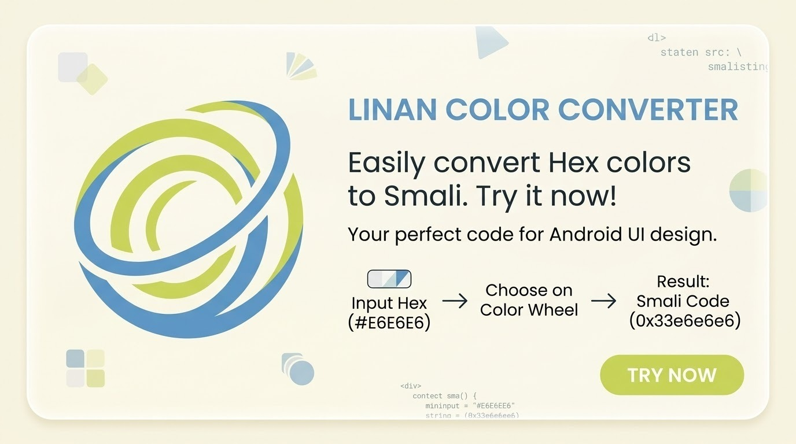

<div align="center">


<a href="https://github.com/TanzirEren/Linan">
  
</a>

<br/>

[](https://github.com/TanzirEren/Linan/releases/latest/download/Linan-v1.0.0.apk)
[](https://github.com/TanzirEren/Linan/releases/latest)
[](https://github.com/TanzirEren/Linan/releases)
[](https://github.com/TanzirEren/Linan/actions)


</div>

---

## ❖ About

**Linan** is a tiny, fast Android tool that converts **Hex colors into Smali color code**. Type a hex value or pick a color on the wheel, tap **Convert**, and get a ready-to-paste Smali value with a live preview.

No more converting `#RRGGBB` to `0xffrrggbb` by hand while editing `.smali` files.

<div align="center">
  
</div>

---

## ✨ How it works

<div align="center">
  
</div>

| Step | What you do | What you get |
|:---:|---|---|
| **1** | Type a hex or tap the 🎨 rainbow button | Color is loaded into the input |
| **2** | Tap **CONVERT TO SMALI** | Smali value, `const` line and live preview |
| **3** | Tap **COPY CODE** or **COPY CONST** | Paste straight into your `.smali` file |

**Example**

```text
Input      #E6E6E6
Smali      0xffe6e6e6
Const      const v0, 0xffe6e6e6
Signed     -0x191a1a
Decimal    -1644826
```

> **Note:** Smali stores colors as `0xAARRGGBB`. A solid color always starts with `ff` (full opacity). Use the opacity slider or an 8-digit hex to change the alpha.

---

## 🚀 Features

| | Feature | Details |
|:---:|---|---|
| 🔁 | **Hex → Smali** | Accepts `RGB`, `ARGB`, `RRGGBB`, `AARRGGBB` with or without `#` |
| 🎨 | **Color wheel picker** | Hue and saturation wheel with brightness and opacity sliders |
| 👁️ | **Live preview** | Big swatch with RGB, HSV and alpha info |
| 🧬 | **Smali `const` line** | Auto uses `const/high16` when the value allows it |
| 🔍 | **Smali Color View** | Paste `0xffe6e6e6`, `-0x191a1a` or a full `const v0, ...` line and see the color |
| 🧾 | **More formats** | Signed (baksmali), decimal, Android XML, Java hex, `Color.parseColor`, RGB |
| 🌈 | **Tints & shades** | Six variations of your color, tap one to convert it |
| 🕘 | **History** | Last 20 colors, tap to reuse, long-press to copy |
| 📋 | **Copy / Paste / Share** | One-tap copy for every format |
| 🪶 | **Zero dependencies** | Pure Java, no external libraries |

---

## 📲 Download & Install

1. Open the **[Releases](https://github.com/TanzirEren/Linan/releases/latest)** page.
2. Under **Assets**, download **`Linan-v1.0.0.apk`**.
3. Open the file. If Android asks, allow **Install unknown apps** for your browser or file manager.
4. Tap **Install**, then open **Linan**.

**Requirements:** Android 5.0 (API 21) or higher.

---

## 🧭 Usage guide

<details>
<summary><b>Convert a hex color</b></summary>

1. Type your hex in the input box, for example `#5B93C7`.
2. Tap **CONVERT TO SMALI**.
3. Copy the value from the result card.

</details>

<details>
<summary><b>Pick a color visually</b></summary>

1. Tap the rainbow circle next to the input.
2. Drag on the wheel, then adjust **Brightness** and **Opacity**.
3. Tap **SELECT**. The color converts automatically.

</details>

<details>
<summary><b>View a Smali color</b></summary>

1. Scroll to **SMALI COLOR VIEW**.
2. Paste a value such as `0xffc5d45a` or `const v0, -0x3a2ba6`.
3. Tap **VIEW COLOR**, then **USE IN CONVERTER** if you want all formats.

</details>

<details>
<summary><b>Use it in a .smali file</b></summary>

```smali
# Before
const v0, 0xff000000

# After (your color)
const v0, 0xff5b93c7

invoke-virtual {p0, v0}, Landroid/view/View;->setBackgroundColor(I)V
```

</details>

---

## 🛠️ Build from source

### Option 1 · GitHub Actions (no setup)

1. Fork or push this repo to GitHub.
2. Open the **Actions** tab and run **Build Linan APK**.
3. Download **Linan-debug-apk** from the run's **Artifacts**.

### Option 2 · Android Studio / Gradle

```bash
git clone https://github.com/TanzirEren/Linan.git
cd Linan
gradle assembleDebug
# APK: app/build/outputs/apk/debug/app-debug.apk
```

Requires JDK 17 and Gradle 8.7.

---

## 📁 Project structure

```text
Linan/
├── .github/workflows/build.yml     CI that builds the APK
├── app/src/main/
│   ├── java/com/linan/colorconverter/
│   │   ├── MainActivity.java       main screen
│   │   ├── ColorWheelView.java     custom HSV wheel
│   │   ├── ColorPickerDialog.java  picker dialog
│   │   ├── SmaliUtils.java         hex ⇄ Smali logic
│   │   ├── HistoryStore.java       saved history
│   │   └── Ui.java                 drawing helpers
│   └── res/                        layouts, icons, banner
├── assets/                         README images
└── README.md
```

---

## ❓ FAQ

**Why does a solid color start with `ff`?**
Smali uses `0xAARRGGBB`. `ff` is full opacity.

**Does it work with `const/high16`?**
Yes. When the lower 16 bits are zero (for example `0xff000000`), Linan outputs `const/high16`.

**Does it need internet or permissions?**
No. Linan works fully offline and requests no permissions.

---

## 🤝 Contributing

Issues and pull requests are welcome. Found a bug or have an idea? [Open an issue](https://github.com/TanzirEren/Linan/issues).

---

<div align="center">

**❖ Linan — Hex to Smali, Made Easy.**

⭐ If Linan helps you, star the repo.

</div>
